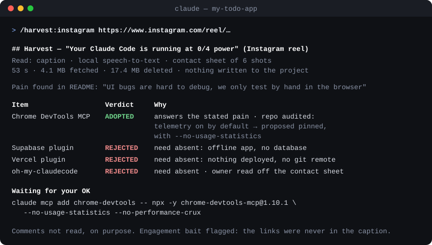

# Harvest

**Turn any link into knowledge your project keeps.**

[](https://github.com/stormcaps/harvest/actions/workflows/ci.yml)
[](LICENSE)
[](https://code.claude.com/docs/en/plugins)


You save a reel, a talk, a thread, a repo "to look at later" — and later never comes. Harvest is
a Claude Code plugin that reads the link for you at the lowest possible cost, checks every tip,
tool and repo it mentions against **what your project already has and what it actually needs**,
audits anything before it could run, and files what is worth keeping where your agents will
read it next session. Then it deletes the media.

```
/plugin install harvest --marketplace stormcaps/harvest
```



## What you can point it at

| Source | Read without any install | With the optional tools |
| --- | --- | --- |
| **Instagram** reels and posts | caption, engagement-bait detection, post picture | speech-to-text, contact sheet |
| **YouTube** videos and Shorts | title, description | chapters, captions in the speaker's language, frames |
| **TikTok** | caption | captions or speech-to-text, frames |
| **X / Twitter** | the author's whole thread, quoted post, X Articles, screenshots | video speech and frames, through yt-dlp |
| **Threads** | first post, picture | video, through a browser |
| **Bluesky** | author's thread, link cards, image alt text, pictures, top replies | video, through yt-dlp |
| **Reddit** | post and top replies, app share links | video, through yt-dlp |
| **Hacker News** | the whole discussion tree | — |
| **GitHub** repos and gists | inventory of skills, commands, agents, hooks, MCP servers and scripts; security audit; licence; changes since the last harvest | — |
| **Articles** — blogs, newsletters, docs, dev.to | clean text and links, extracted on your machine | — |
| **Any other video** yt-dlp supports (Loom and ~1,800 more) | — | description, captions, speech, frames |

## Install

Inside Claude Code (v2.1.275 or later):

```
/plugin install harvest --marketplace stormcaps/harvest
```

On older versions, two commands:

```
/plugin marketplace add stormcaps/harvest
```

```
/plugin install harvest@harvest
```

To receive new versions automatically, turn on **auto-update** for the `harvest` marketplace in
`/plugin` › Marketplaces. Requires **Node.js 22+**. Run `/harvest:doctor` to see which optional
tools are missing and what each one unlocks:

| Tool | Unlocks | Windows | macOS | Linux |
| --- | --- | --- | --- | --- |
| [yt-dlp](https://github.com/yt-dlp/yt-dlp#installation) | every video source: descriptions, captions, audio, frames | `winget install yt-dlp.yt-dlp` (installs FFmpeg with it) | `brew install yt-dlp` | `pipx install yt-dlp` |
| [FFmpeg](https://ffmpeg.org/download.html) | contact sheets, kept frames, audio for speech-to-text | comes with yt-dlp above | `brew install ffmpeg` | your package manager |
| [whisper.cpp](https://github.com/ggml-org/whisper.cpp) | speech-to-text when a video has no captions — most reels | `whisper-bin-x64.zip` from the [releases](https://github.com/ggml-org/whisper.cpp/releases), folder added to `PATH` | `brew install whisper-cpp` | [build it](https://github.com/ggml-org/whisper.cpp#quick-start) |
| a whisper model | what whisper.cpp runs | [`ggml-base.bin`](https://huggingface.co/ggerganov/whisper.cpp/tree/main) (142 MB, multilingual) in a `models/` folder beside `whisper-cli`, or `HARVEST_WHISPER_MODEL` set to its path | same | same |

YouTube needs a JavaScript runtime since yt-dlp 2025.11; Harvest hands yt-dlp the Node.js that is
already running, so Deno is optional.

## Use

Share a link and ask what is in it — the `harvest` skill triggers on its own — or name the source:

| Command | Reads |
| --- | --- |
| `/harvest:harvest <url>` | any link: detects the source |
| `/harvest:instagram` · `/harvest:youtube` · `/harvest:tiktok` | short and long video, caption first |
| `/harvest:x` · `/harvest:threads` · `/harvest:bluesky` | posts and threads |
| `/harvest:reddit` · `/harvest:hackernews` | discussions |
| `/harvest:github` · `/harvest:article` · `/harvest:video` | repos and gists, pages, any other video |
| `/harvest:doctor` | installed tools, and what each missing one unlocks |

Three typical runs:

- **A reel that says "comment CODE for the links."** The caption carries nothing, so Harvest
  transcribes the speech locally, reads the repo names off one contact sheet, and checks each tool
  against your README's own complaints. You get a verdict per tool, and the install commands only
  for the ones you need — pinned, with their telemetry switched off when the audit finds it.
- **A 40-minute talk.** It reads the chapters first, takes the captions in the speaker's language,
  compressed into timestamped paragraphs, and reads only the parts that match your project. The
  tips land in the doc that already covers the topic, each with its source and timestamp.
- **"Look at this repo."** It downloads one commit's archive — no clone — inventories it, audits it
  (load-time commands, hooks, install scripts, unpinned or remote MCP servers, credential reads,
  hidden Unicode, prompt injection), checks the licence, and tells you which one or two ideas are
  worth folding into what you already have. Next time, it reads only what changed.

## How it works

**1 · Read at the lowest tier that captures the content.**

| Tier | What | Measured |
| --- | --- | --- |
| 0 · text | caption, post, thread, description, chapters, README | 0.1–2 s; a 12-post X thread in 1.4 s |
| 1 · captions | the speaker's own language, human captions before automatic ones, compressed into timestamped 30-second paragraphs | an 18-minute video in 9 s, 19 KB of text |
| 2 · speech | local speech-to-text when there are no captions | a 46-second reel in 12 s on a laptop CPU |
| 3 · images & screen | the pictures of a post, or **one** contact sheet of a video — shots at scene cuts, evenly spaced for screen recordings | a sheet in about 6 s for a 46-second reel |
| 4 · browser | your agent's browser tool, page text only — for login walls and pages built by script | when the tiers above fail |

Media is downloaded at the lowest usable resolution into the plugin's own `.work/` folder — never
into your project — and **deleted** at the end of the harvest, with the bytes reported. Leftovers
of an interrupted run are swept after 24 h. No image is kept by default; a link and a timestamp
let you go back. One or two frames are kept, as small WebP files, only when a visual cannot be
put into words.

**2 · Triage every item against your project.** Harvest reads your README, status files and TODOs
for what hurts, and searches the repo for what you already have. "We already have it" names the
file; "we don't" states what was searched. Each item gets one verdict:

- **ADOPTED** — new and useful: written into the project, or proposed for install and waiting for your yes
- **MERGED** — its differences folded into an existing document, never a second file beside it
- **DEFERRED** — useful later, written where that work will find it
- **REJECTED** — need absent, complete duplicate, risk, or pollution — always named
- **UNVERIFIED** — not fully read, a claim that cannot be checked, or a tier not climbed

It also looks for a better or smaller alternative — a built-in feature, a better-maintained tool,
or the ten lines you actually need rewritten in place instead of a whole dependency — and spends
reading only where there is a need: an item with no use for your project is not downloaded to be
audited.

**3 · Audit before anything runs.** Plugins, MCP servers, packages, skills, hooks and scripts are
scanned for load-time commands, hooks, install scripts, `curl | sh`, credential reads, unpinned or
remote MCP servers (read as JSON, not grepped), hidden Unicode, prompt injection, prebuilt binaries
and the hosts the code talks to. Findings in tests and build files weigh less; files too big to
scan are listed, never skipped silently. The licence decides what can be copied and what can only
be reused as an idea. Nothing is installed without your yes.

**4 · File it where your agents will look.** Harvest profiles the repository first:

| Level | The repo has | Knowledge goes |
| --- | --- | --- |
| 0 | nothing | a small `docs/knowledge/` with an index, plus one line in `CLAUDE.md` so the agent finds it (asked first) |
| 1 | an instruction file | one-line rules there; the detail in `docs/knowledge/` |
| 2 | structured docs, decision records | into the doc that covers the topic, its index, a decision record |
| 3 | skills, libraries, several repos | merged into the skill or library that owns the topic, upstream when shared |

A project that documents its own intake process is followed instead. Every kept item carries its
source line — URL, author, date, timestamp — which is also how the next harvest knows it was
already read. No separate log file.

## How it compares

Most link tools summarise one source. Harvest is built for a different question: *what should my
project do with this?*

| | A summariser skill | Harvest |
| --- | --- | --- |
| Sources | usually one (often YouTube) | 11 sources, plus ~1,800 video sites through yt-dlp |
| Output | a summary to read | a verdict per item, against your repo's stated needs |
| "Do we already have this?" | not asked | measured, with the file named |
| Running something it found | up to you | audited first; nothing installed without your yes |
| Where it ends up | the chat | the doc, skill or library your agents already read |
| Disk | varies | media deleted, bytes reported |

## Privacy and network

Harvest reads only public content and never logs in, posts, comments or likes. It contacts:

- the site of the link you give it — its page, oEmbed endpoint and media CDN (images, video, audio);
- [FxTwitter](https://github.com/FxEmbed/FxEmbed) (`api.fxtwitter.com`) for X posts;
- the Bluesky public API (`public.api.bsky.app`), the Reddit post feed, the Algolia Hacker News
  API (`hn.algolia.com`), the dev.to API;
- the GitHub API (`api.github.com`) and `codeload.github.com` for repos and gists — anonymously;
- whatever [yt-dlp](https://github.com/yt-dlp/yt-dlp) contacts to read a video.

It reads no credential from your environment and sends nothing about your project anywhere.
Articles are extracted on your machine — no third-party reader service. Speech-to-text runs on
your machine with whisper.cpp. The only programs it starts are yt-dlp, FFmpeg/ffprobe,
whisper-cli, tar, and git (read-only: your repo's remote and status), each without a shell. There is no telemetry.

## Limits

Measured on 2026-10-13 and 14 — platforms change, and so may these.

- **Reddit** answers about one anonymous read a minute; a burst gets a 429, and the skill waits or
  uses a browser.
- **Threads** previews give the first post only. **LinkedIn** posts and **Vimeo** videos need a
  login.
- **Instagram carousels** preview their first slide only; the others are read through a browser.
- **GitHub** is read anonymously: 60 API requests an hour, two per repository.
- **Automatic text** — captions or speech-to-text — mangles names and jargon ("Versailles" for
  Vercel). The skill corrects from context and flags it; quotes from it deserve a second look.
- If a video source fails, update yt-dlp first.

## FAQ

**Does it work without yt-dlp or whisper?** Yes. Every text source works with Node.js alone;
videos fall back to their description or caption, and the report says which tiers were out of
reach.

**Does it work outside Claude Code?** The skills are Claude Code skills, but everything mechanical
is a dependency-free Node.js script any agent or terminal can run:
`node scripts/harvest.mjs read <url>` — run it without arguments for `read`, `transcript`,
`frames`, `images`, `keep-frame`, `clean`, `audit`, `profile`, `detect`, `guide` and `doctor`.

**Will it change my project without asking?** It asks before touching an instruction file
(`CLAUDE.md`, `AGENTS.md`…), creating a folder structure, or installing anything. Edits to an
existing knowledge document you asked it to harvest into may go ahead.

**Where do the temporary files go?** Into the plugin's own `.work/` folder, outside your project.
`HARVEST_WORK` moves it under another parent directory.

**Is it safe to point at a malicious repo?** It downloads an archive and reads it as text; it never
runs anything from it. The audit narrows where to look, and the skill reads every finding before
recommending anything — a clean audit means nothing known-bad was found, not that it is safe.

## Development

```
npm test
```

```
.claude-plugin/   plugin and marketplace manifests
skills/harvest/   the method: SKILL.md + references (triage, security, integrate, reading)
skills/<source>/  one command per source, with what is specific to it
scripts/          the CLI and its modules — Node.js only, no dependencies
test/             offline tests on synthetic fixtures
docs/             the README's demo image
```

Tests never touch the network. A new source is welcome as an issue first, with the public
endpoint it would use and a measurement of what it returns.

**Releasing:** bump `version` in `.claude-plugin/plugin.json` and add a `CHANGELOG.md` entry with
every published change. Claude Code updates an installed plugin only when that version changes —
commits alone never reach users.

## License

[MIT](LICENSE)
